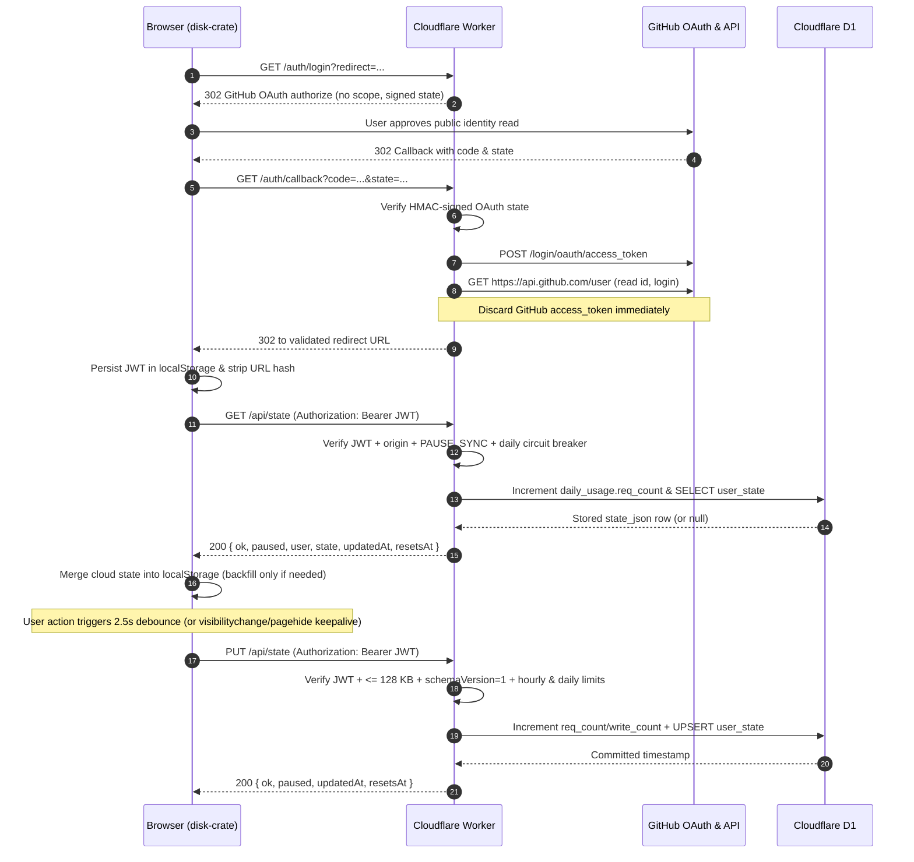

# Architecture Design: GitHub Cloud Sync (Cloudflare Worker + D1)

This document describes the as-built architecture, deployment topology, API contract, storage schema, conflict-merge and quota-conservation rules, security model, and verification layers for optional per-user cloud sync in **Disk Crate** (`disk-crate`, formerly `cd-hunt`).

---

## 1. Overview & Core Design Goals

- **Local-First & Offline-Safe:** `localStorage` remains the immediate primary store so `index.html` renders instantaneously and continues working in basement shops with no cellular reception. Cloud sync runs asynchronously in the background.
- **Zero-Scope GitHub OAuth (`scope=""`):** `/auth/login` omits the `scope` parameter completely, requesting read-only public profile identity only (zero access to Gists, private repositories, or repository writes).
- **Immediate GitHub Token Discard:** `/auth/callback` exchanges the OAuth `code`, calls `GET https://api.github.com/user` once to read `{ id, login, avatar_url }`, and **immediately discards GitHub's `access_token`**. The Worker issues its own HMAC-SHA256 session JWT (`30d` TTL) scoped solely to Disk Crate's Worker API, so no GitHub credential is persisted anywhere.
- **Personal Metadata Auto-Discovery:** When signed in as `<login>` with no active catalog loaded, Disk Crate checks `https://raw.githubusercontent.com/<login>/cd-metadata/main/index.json` first and surfaces that user's personal presets, falling back cleanly to `dopingus-build/cd-metadata` on `404` or error.
- **Self-Pausing Free-Tier Circuit Breaker:** Per-user hourly write caps, payload size guards, and an 80% global UTC daily threshold keep usage safely inside Cloudflare's free tier and surface structured degraded statuses instead of hard platform failures.

---

## 2. Deployment Topology & Components

| Component | Location / Live Coordinate | Role |
| --- | --- | --- |
| **Static Web App** | [`https://dopingus-build.github.io/disk-crate/`](https://dopingus-build.github.io/disk-crate/) ([`index.html`](../index.html), [`css/styles.css`](../css/styles.css)) | Zero-build UI shell hosting toolbar sync controls (`#syncStatusPill`, `#githubAuthBtn`, `#copyAgentLinkBtn`, `#githubSignOutBtn`). |
| **Frontend Config** | [`js/config.js`](../js/config.js) | Exposes `window.DiskCrate.config.syncApiUrl = 'https://cd-hunt-sync.tndo.workers.dev'` (with legacy alias `window.CDHunt.config`; setting `''` disables cloud sync cleanly for forks or local standalone bundles). *(Worker hostname intentionally kept stable for now; see [`plans/OVERVIEW.md`](./plans/OVERVIEW.md).)* |
| **Frontend Sync Client** | [`js/sync.js`](../js/sync.js) | Session JWT capture (`#auth_token=`) & validation, loopback-only `?syncApi=` override resolution (`cd_hunt_sync_api_url_v1`), custom-cover extraction, state merge, and `/api/state` HTTP calls. |
| **Google Sheet CSV Adapter** | [`js/sheet-adapter.js`](../js/sheet-adapter.js) | RFC-4180 CSV parser supporting both Dashboard and Flat Table canonical 9-column Google Sheets, hybrid JSON overlay merging (`meta.googleSheetUrl`), and catalog-number checklist mapping for write-back. |
| **App Controller** | [`js/app.js`](../js/app.js) | Startup pull/merge/backfill, `<login>/cd-metadata` discovery, Google Sheet & hybrid JSON loading, 2.5s debounced explicit-mutation push (including optional `sheetSync` payload), mobile `visibilitychange`/`pagehide` `keepalive` flush, **Agent Link** clipboard copy, and pill status transitions. |
| **Cloudflare Worker** | `cd-hunt-sync` (`https://cd-hunt-sync.tndo.workers.dev`, [`worker/index.mjs`](../worker/index.mjs) -> [`worker/index.js`](../worker/index.js)) | Stateless OAuth handler, CORS origin checker, HMAC-SHA256 JWT signer/verifier (`session` + `read_share`), semi-private `/api/share/<token>` JSON/Markdown reader, RS256 Google Service Account Sheets API v4 Column A write-back, payload validator, rate limiter, and daily circuit breaker. |
| **Cloudflare D1** | `cd-hunt-db` (UUID `d09adf93-b9ba-4198-896a-5faa1bfcda08`, [`worker/schema.sql`](../worker/schema.sql)) | SQLite storage for per-user synced state JSON, hourly per-user write counters, and global daily UTC usage counters. |

- **Wrangler Configuration ([`worker/wrangler.toml`](../worker/wrangler.toml)):** Pins public `GITHUB_CLIENT_ID = "Ov23liJMYOGioIFPGvzK"`, comma-separated `ALLOWED_ORIGINS = "https://dopingus-build.github.io"`, `APP_REDIRECT_URL = "https://dopingus-build.github.io/disk-crate/"`, `DAILY_REQ_LIMIT = "80000"`, `DAILY_WRITE_LIMIT = "80000"`, `USER_HOURLY_WRITE_LIMIT = "60"`, `MAX_PAYLOAD_BYTES = "131072"`, and `PAUSE_SYNC = "false"`.

---

## 3. Request Flow & Worker API Contract



### Worker Endpoints ([`worker/index.js`](../worker/index.js))

| Endpoint | Method | Auth | Behavior & Responses |
| --- | --- | --- | --- |
| `/auth/login` | `GET` | Public | Signs an HMAC `oauth_state` JWT (`10m` TTL, optional validated `redirect` matching `ALLOWED_ORIGINS` or loopback when `ALLOW_LOCALHOST = "true"`) and returns `302` to GitHub OAuth (`scope` omitted). `400` bad redirect, `500` missing OAuth config. |
| `/auth/callback` | `GET` | `state` JWT | Verifies `state`, exchanges `code` with `GITHUB_CLIENT_ID` + `GITHUB_CLIENT_SECRET`, fetches `/user`, discards GitHub token, mints session JWT (`30d` TTL), and returns `302` to validated redirect URL `#auth_token=<jwt>`. `400` invalid params/state, `502` GitHub failure. |
| `/api/state` | `GET` | Bearer JWT | Verifies origin (`403`), JWT (`401`), `PAUSE_SYNC` & daily request threshold (`503`), increments `req_count`, and returns `{ ok: true, paused: false, user, state, updatedAt, resetsAt, shareToken, shareUrl }`. |
| `/api/state` | `PUT` | Bearer JWT | Verifies origin (`403`), JWT (`401`), `PAUSE_SYNC` & daily write threshold (`503`), payload size `<= MAX_PAYLOAD_BYTES` (`413`), schema validation (`400`), per-user hourly cap (`429` + `Retry-After`), strips transient `sheetSync`, increments counters, upserts `user_state`, optionally syncs Column A (`Got it?`) back to Google Sheets via `GOOGLE_SERVICE_ACCOUNT_JSON`, and returns `{ ok: true, paused: false, updatedAt, resetsAt, shareToken, shareUrl, sheetSync? }`. |
| `/api/share/<token>` | `GET` | Capability JWT (`90d` TTL) | Public read-only endpoint (`Access-Control-Allow-Origin: *`, `Cache-Control: no-store`) for AI / LLM agents lacking GitHub credentials. Verifies `purpose === 'read_share'` (`401`), obeys daily read circuit breaker (`503`), strips custom covers/internal fields, and returns `{ ok, user: { login }, updatedAt, activeCatalogUrl, catalogs }` or Markdown via `?format=markdown`. Also accepts `/api/share?token=<token>`. |
| `/api/status` | `GET` | Public | Verifies origin (`403`) and returns `{ ok: true, paused, reason, utcDate, resetsAt, usage: { reqCount, writeCount }, limits, sheetSync: { configured, serviceAccountEmail } }` without consuming write quota. |
| `/*` | `OPTIONS` | Origin | CORS preflight (`204` if origin allowed, `403` otherwise). Unknown routes/methods return `404`/`405`. |

---

## 4. Storage Architecture (`D1` & Browser `localStorage`)

### Cloudflare D1 Schema ([`worker/schema.sql`](../worker/schema.sql))

```sql
CREATE TABLE IF NOT EXISTS user_state (
  github_id   TEXT PRIMARY KEY,
  github_login TEXT NOT NULL,
  state_json  TEXT NOT NULL,
  updated_at  INTEGER NOT NULL,
  hour_window INTEGER NOT NULL DEFAULT 0,
  hour_writes INTEGER NOT NULL DEFAULT 0
);

CREATE TABLE IF NOT EXISTS daily_usage (
  utc_date    TEXT PRIMARY KEY,
  req_count   INTEGER NOT NULL DEFAULT 0,
  write_count INTEGER NOT NULL DEFAULT 0
);
```

- **`hour_window` / `hour_writes`:** `Math.floor(Date.now() / 3600000)` resets `hour_writes` to `1` atomically on hour rollover via SQLite `ON CONFLICT ... DO UPDATE`.
- **`utc_date`:** `YYYY-MM-DD` UTC row key provides automatic midnight UTC resets with zero cron jobs.

### Browser `localStorage` Cloud Sync Keys

Alongside derived per-catalog keys (`<prefix>_checklist_v2`, `<prefix>_cover_cache_v6`, `<prefix>_view_mode_v1`, `<prefix>_note_dismissed_v1`, `<prefix>_sheet_csv_v1`) and `cd_hunt_catalog_url_v1` (preserving legacy `cd_hunt_*` names intentionally for backwards compatibility), [`js/sync.js`](../js/sync.js) manages:

- `cd_hunt_sync_token_v1`: Signed Disk Crate session JWT (`sub`, `login`, `avatarUrl`, `exp`).
- `cd_hunt_sync_api_url_v1`: Explicit loopback dev override (`http://localhost:*` / `http://127.0.0.1:*`) set via `?syncApi=`; cleared via `?syncApi=off|reset|""`. Non-loopback query overrides are ignored to prevent token exfiltration.
- `cd_hunt_sync_meta_v1`: Local sync baseline metadata (`{ updatedAt, activeCatalogUrl, catalogs: { [prefix]: updatedAt } }`).

---

## 5. Synced Payload, Merge Rules & Quota Conservation

### `state_json` Schema (`schemaVersion: 1`)

```json
{
  "schemaVersion": 1,
  "updatedAt": 1795138200000,
  "activeCatalogUrl": "https://raw.githubusercontent.com/dopingus-build/cd-metadata/main/2026-japan.json",
  "catalogs": {
    "cd_hunt_osaka_cd_cover_a1b2c3d4": {
      "updatedAt": 1795138200000,
      "checklist": {
        "cd-01": true,
        "cd-04": true
      },
      "customCovers": {
        "cd-01": {
          "variants": [
            {
              "url": "https://example.com/custom-jacket.jpg",
              "label": "通常盤 Regular",
              "catNo": "CPCA-1004",
              "source": "custom",
              "isRegular": true
            }
          ],
          "selectedIndex": 0
        }
      },
      "selectedVariants": {
        "cd-01": { "url": "https://example.com/custom-jacket.jpg", "selectedIndex": 0 },
        "cd-04": { "url": "https://coverartarchive.org/release/.../front-500", "selectedIndex": 1 }
      },
      "viewMode": "grid",
      "noteDismissed": false
    }
  }
}
```

### Compact Payload Design (Custom Covers Only)
- Public MusicBrainz (`musicbrainz`) and Apple iTunes (`itunes-*`) candidates are never synced because browsers re-fetch them lazily from public APIs.
- Syncing **only `source === 'custom'` entries** in `customCovers` plus `{ url, selectedIndex }` in `selectedVariants` keeps full catalogs around `1–5 KB`, well beneath the `128 KB` D1 payload ceiling.

### Conflict Merge & Write-Conservation Rules
1. **Unbaselined Startup Safety (`updatedAt: 0`):** When a clean device (`cd_hunt_sync_meta_v1` absent, no open catalog edits) builds its startup local snapshot via `buildLocalSyncPayload`, top-level `updatedAt` defaults to `0` rather than `Date.now()`. That ensures `mergeAndApplyCloudState` sets `changedRemote = false` when cloud already holds state — eliminating unnecessary `PUT /api/state` backfill writes on fresh second-device logins (`flushCloudPush` stamps `Date.now()` whenever an actual `PUT` occurs).
2. **First-Time Offline Merge vs. Established Baselines:**
   - **No local baseline (`localEntry.updatedAt === 0`):** `mergeCatalogState` unions `checklist` (`true` if checked locally OR in cloud) so offline pre-login progress merges without loss.
   - **Baselined devices (`localEntry.updatedAt > 0`):** The newer `updatedAt` wins for explicit unchecks, `viewMode`, and `noteDismissed`; custom cover variants deduplicate by `url` while preserving local + remote additions.
3. **Explicit-Mutation Debounce + Mobile `keepalive` Flush:**
   - `scheduleCloudPush()` runs **only** on explicit user actions (acquired toggle, edition selection/deletion/custom cover save, `1-Col`/`Grid` toggle, digital note banner dismiss/restore, backup import, interactive catalog URL load).
   - Background cover auto-resolution (`resolveCoverForAlbum`) writes strictly to local cache and **never** calls `scheduleCloudPush()`. It also re-reads `source === 'custom'` entries after awaiting MusicBrainz/iTunes fetches so in-flight background lookups never clobber concurrently saved custom covers.
   - Rapid edits coalesce under a `2500ms` debounce (`DiskCrate.config.syncDebounceMs` / legacy `CDHunt.config.syncDebounceMs`, configurable in tests). When switching or closing mobile tabs, `visibilitychange` (`hidden`) and `pagehide` immediately call `flushPendingCloudPush({ keepalive: true })`, forwarding `keepalive: true` on `fetch` and clearing `syncPushTimer = null` so each edit flushes at most once.

---

## 6. Free-Tier Quotas, Circuit Breaker & UI States

| Resource | Cloudflare Free Plan | Configured Cap (`80%` Buffer) | Enforced HTTP Response |
| --- | --- | --- | --- |
| **Worker Requests** | `100,000` / UTC day | `80,000` / UTC day (`DAILY_REQ_LIMIT`) | `HTTP 503` paused JSON |
| **D1 Row Writes** | `100,000` / UTC day | `80,000` / UTC day (`DAILY_WRITE_LIMIT`) | `HTTP 503` paused JSON |
| **D1 Storage / Row Size** | `5 GB` total | `128 KB` / payload (`MAX_PAYLOAD_BYTES = 131072`) | `HTTP 413` JSON |
| **Per-User Burst Cap** | — | `60` writes / UTC hour / `github_id` (`USER_HOURLY_WRITE_LIMIT`) | `HTTP 429` + `Retry-After` |
| **Manual Kill Switch** | — | `PAUSE_SYNC = "true"` | `HTTP 503` (`reason: "manual_pause_enabled"`) |

Paused `503` payload format:

```json
{
  "ok": false,
  "paused": true,
  "reason": "daily_free_tier_limit_reached",
  "resetsAt": "2026-11-22T00:00:00Z"
}
```

### Frontend `#syncStatusPill` State Matrix

When `(window.DiskCrate || window.CDHunt).config.syncApiUrl === ''`, `#syncStatusPill`, `#githubAuthBtn`, and `#githubSignOutBtn` all remain hidden with zero network calls. When enabled and signed in:

| Condition | `#syncStatusPill` Text | Behavior |
| --- | --- | --- |
| Normal pull/push complete | `@<login> · Synced` | Green (`sync-pill-ok`). |
| Debounce window open | `@<login> · Pending...` | Muted (`sync-pill-muted`); flushed on timer or `visibilitychange`/`pagehide`. |
| Network request in flight | `@<login> · Syncing...` | Muted (`sync-pill-muted`). |
| `HTTP 503` (`paused: true`) | `@<login> · Paused until 00:00 UTC` | Amber (`sync-pill-warn`); sets `syncPausedUntil` so subsequent local edits short-circuit locally without network calls. |
| `HTTP 429` | `@<login> · Rate limited — saved locally` | Amber (`sync-pill-warn`). |
| `HTTP 413` | `@<login> · Too large for cloud — local only` | Amber (`sync-pill-warn`). |
| Offline / network error | `@<login> · Offline — saved locally` | Muted (`sync-pill-muted`); edits stay in `localStorage`. |
| `HTTP 401` | `Session expired` | Amber (`sync-pill-warn`); clears `cd_hunt_sync_token_v1` and re-shows `#githubAuthBtn` while keeping all local progress. |

---

## 7. Security Model

- **Publicly Committed Files (`disk-crate/worker/`):** [`worker/index.js`](../worker/index.js), [`worker/index.mjs`](../worker/index.mjs), [`worker/schema.sql`](../worker/schema.sql), [`worker/wrangler.toml`](../worker/wrangler.toml) (public `GITHUB_CLIENT_ID`, D1 UUID, non-secret `[vars]`).
- **Encrypted Cloudflare Secrets (`wrangler secret put`):** `GITHUB_CLIENT_SECRET`, `JWT_SECRET`, and optional `GOOGLE_SERVICE_ACCOUNT_JSON` for two-way Column A Google Sheet checkoff sync (never committed; local `.dev.vars` and `.wrangler/` are gitignored).
- **Origin & Token Controls:**
  - CORS and OAuth `?redirect=` validate strictly against comma-separated `ALLOWED_ORIGINS` (plus localhost/127.0.0.1 only when `ALLOW_LOCALHOST = "true"`).
  - Unauthenticated calls to `/api/state` fail with `HTTP 401`.
  - HMAC-SHA256 JWT signatures verify using constant-time Web Crypto `crypto.subtle.verify`.
  - Strict `validateSyncPayload` rejects non-v1 schemas or keys not matching `/^cd_hunt_[a-z0-9_]+_[0-9a-f]{8}$/`.

---

## 8. Verification & Test Architecture

Every automated layer uses Node's built-in `node:test` and `node:sqlite` (`zero` committed `package.json`/`node_modules`):

| Layer | Files | Workflow | Coverage / Scope |
| --- | --- | --- | --- |
| **Frontend Unit Tests** | [`test/catalog-validation.test.js`](../test/catalog-validation.test.js) | [`test.yml`](../.github/workflows/test.yml) | Schema validator, storage derivation, cover resolver, `js/config.js`, `js/sync.js` merge/JWT/keepalive, Wrangler secret hygiene. |
| **Worker Unit Tests** | [`test/worker-sync.test.js`](../test/worker-sync.test.js) | [`test.yml`](../.github/workflows/test.yml) | OAuth zero-scope URLs & state tampering, JWT verify, comma-separated `ALLOWED_ORIGINS`, `413`/`429`/`503`/`PAUSE_SYNC`. |
| **Frontend Integration** | [`test/catalog-integration.test.js`](../test/catalog-integration.test.js) | [`test.yml`](../.github/workflows/test.yml) | DOM/UI wiring, presets, Crate Flip lightbox, cloud restore/sign-out, `keepalive`, `413`/`429`/`503`/`401`/offline degradation, write coalescing. |
| **Worker HTTP + SQLite Integration** | [`test/worker-integration.test.js`](../test/worker-integration.test.js) | [`test.yml`](../.github/workflows/test.yml) | Live HTTP Worker + `node:sqlite` multi-session round trips, user isolation, atomic `ON CONFLICT` limits, CORS preflight. |
| **Full-Stack System Tests** | [`test/cloud-sync-system.test.js`](../test/cloud-sync-system.test.js) | [`test.yml`](../.github/workflows/test.yml) | Real frontend (`index.html` + `js/*.js`) wired directly to loopback HTTP `worker/index.mjs` + `node:sqlite`: OAuth flow, two-device sync, baseline unchecks, union merge, zero startup backfill, SQLite `write_count` conservation. |
| **Headless Chromium E2E** | [`scripts/e2e-browser.mjs`](../scripts/e2e-browser.mjs) | [`e2e-browser.yml`](../.github/workflows/e2e-browser.yml) | Ephemeral Playwright Chromium (`/tmp/pw`): desktop `1280x800` + mobile `375x812` overflow checks, real browser CORS, OAuth redirect interception, custom cover persistence across reload, cross-context sync, and real `visibilitychange` `keepalive` flush. |
| **Live Deployment Smoke** | [`scripts/smoke-live.mjs`](../scripts/smoke-live.mjs) | [`smoke-live.yml`](../.github/workflows/smoke-live.yml) | Runs automatically after GitHub Pages deployments (`deployment_status`), daily on schedule, and manually to assert live Pages assets, Worker `/api/status`, CORS preflight/rejection, zero-scope `/auth/login`, and `401` guards. |
