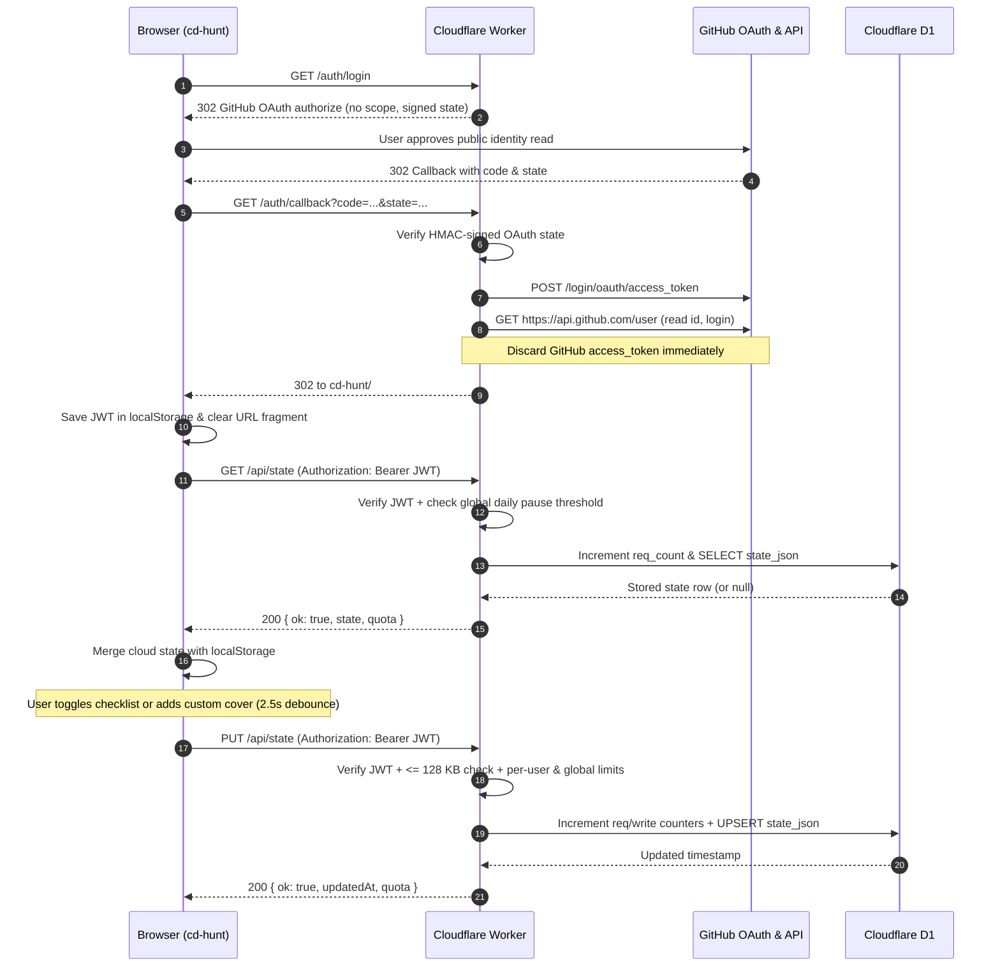

# Concept & Plan: GitHub User-Specific Shared Cloud Sync (`Cloudflare Worker + D1`)

This document outlines the architecture, security model, database schema, free-tier circuit breaker, conflict merge strategy, and implementation roadmap for adding optional per-user cloud sync to **CD Hunt** (`cd-hunt`).

---

## 1. Overview & Design Goals

- **Local-First & Offline-Safe:** `localStorage` remains the immediate primary store so the web app (`index.html`) loads instantaneously and works inside basement shops with zero cell reception. Cloud sync runs opportunistically in the background.
- **Zero-Scope GitHub OAuth (`scope=""`):** Authentication requests **no write or private-data scopes** from GitHub (no access to Gists, private repos, or public repo writes). On GitHub's consent screen, users see *"Public data only — Limited read-only access to public information"*.
- **Immediate GitHub Token Discard:** Inside `/auth/callback`, the Cloudflare Worker exchanges the authorization `code` for a temporary GitHub access token, calls `GET https://api.github.com/user` once to read `{ id, login, avatar_url }`, and **immediately discards the GitHub token**. The Worker mints its own HMAC-SHA256 session JWT scoped exclusively to CD Hunt's sync API (`{ sub: github_id, login, avatarUrl, exp }`), so no GitHub credential is ever stored in the browser or database.
- **Automatic User Catalog Discovery:** Once signed in as `<login>`, if the user has no active catalog selected yet, CD Hunt checks `https://raw.githubusercontent.com/<login>/cd-metadata/main/index.json` first and surfaces that user's personal catalog presets (falling back cleanly to `dopingus-build/cd-metadata` presets if they do not have a `cd-metadata` repo).
- **Self-Pausing Free-Tier Guard:** The Worker enforces per-user rate limits, payload caps, and a daily global free-tier circuit breaker so usage stays safely inside Cloudflare's free tier (zero risk of overage bills and clean degraded JSON responses instead of opaque platform error pages).

---

## 2. Architecture & Request Flow



### Worker API Endpoints (`cd-hunt/worker/index.js`)

| Endpoint | Auth | Behavior |
| --- | --- | --- |
| `GET /auth/login` | Public | Generates an HMAC-signed CSRF `state` token (with nonce + expiry) and redirects to `https://github.com/login/oauth/authorize` with `client_id` and **no `scope` parameter**. |
| `GET /auth/callback` | Public (`state` verified) | Verifies `state`, exchanges `code` via `GITHUB_CLIENT_ID` + `GITHUB_CLIENT_SECRET`, fetches `{ id, login, avatar_url }` from `https://api.github.com/user`, discards the GitHub token, signs an HMAC-SHA256 CD Hunt session JWT (`30d` expiry), and redirects to `https://dopingus-build.github.io/cd-hunt/#auth_token=<jwt>`. |
| `GET /api/state` | Bearer JWT | Verifies JWT signature & expiry, checks `PAUSE_SYNC` override and daily request circuit breaker, increments `daily_usage.req_count`, reads `user_state` from D1, and returns `{ ok: true, paused: false, user, state, updatedAt, quota }`. |
| `PUT /api/state` | Bearer JWT | Verifies JWT, checks `PAUSE_SYNC` override, enforces `<= 128 KB` body limit (`413`), checks per-user hourly write quota (`429`), checks global daily circuit breaker (`503` paused), increments counters, upserts `user_state`, and returns `{ ok: true, updatedAt, quota }`. |
| `GET /api/status` | Public | Returns non-sensitive operational status (`{ ok: true, paused, utcDate, resetsAt, limits }`) so clients can inspect sync health without consuming write quota. |

---

## 3. Cloudflare D1 Schema (`worker/schema.sql`)

```sql
-- Per-user synced CD Hunt state + per-user hourly rate-limit tracking
CREATE TABLE IF NOT EXISTS user_state (
  github_id   TEXT PRIMARY KEY,
  github_login TEXT NOT NULL,
  state_json  TEXT NOT NULL,
  updated_at  INTEGER NOT NULL,
  hour_window INTEGER NOT NULL DEFAULT 0,
  hour_writes INTEGER NOT NULL DEFAULT 0
);

-- Daily global UTC usage counters for the free-tier self-pause circuit breaker
CREATE TABLE IF NOT EXISTS daily_usage (
  utc_date    TEXT PRIMARY KEY,
  req_count   INTEGER NOT NULL DEFAULT 0,
  write_count INTEGER NOT NULL DEFAULT 0
);
```

- **`hour_window`:** Integer `Math.floor(Date.now() / 3600000)`. When `hour_window` rolls over for a user, `hour_writes` resets to `1` atomically during the `UPSERT`.
- **`utc_date`:** ISO UTC date string (`YYYY-MM-DD`). Automatically creates a clean counter row at `00:00 UTC` without requiring cron jobs.

---

## 4. Free-Tier Quotas & Self-Pausing Circuit Breaker Rules

Cloudflare Workers Free + D1 Free plans reset daily at `00:00 UTC` and never bill overages automatically. The Worker adds an application-level safety buffer at **80%** so `cd-hunt` receives structured JSON and degrades gracefully before Cloudflare's hard platform cutoff triggers.

| Resource | Cloudflare Free Plan Limit | Soft Circuit-Breaker Limit (`80%`) | Enforcement Behavior |
| --- | --- | --- | --- |
| **Worker Requests** | `100,000` / UTC day | `80,000` / UTC day | Returns `HTTP 503` paused JSON |
| **D1 Row Reads** | `5,000,000` / UTC day | Covered cleanly (~1 read per `/api/state`) | Protected by daily request cap |
| **D1 Row Writes** | `100,000` / UTC day | `80,000` / UTC day | Blocks `/api/state` writes with `HTTP 503` |
| **D1 Storage** | `5 GB` total | `128 KB` max `state_json` per user | Returns `HTTP 413` if payload > `128 KB` |
| **Per-User Burst Guard** | — | `60` writes / UTC hour / `github_id` | Returns `HTTP 429` with `retryAfterSeconds` |
| **Manual Kill Switch** | — | Env var `PAUSE_SYNC = "true"` | Immediately pauses writes & returns `paused: true` |

### Paused Response Format & Frontend UX

When the global daily limit (or `PAUSE_SYNC = "true"`) is reached, the Worker returns:

```json
{
  "ok": false,
  "paused": true,
  "reason": "daily_free_tier_limit_reached",
  "resetsAt": "2026-11-21T00:00:00Z"
}
```

Frontend fallback behavior:
1. All local edits still commit immediately to `localStorage`.
2. A non-intrusive status pill switches to `"Cloud sync paused until 00:00 UTC — saved locally"` and marks pending local changes `dirty`.
3. No retry loop runs while paused; the next session or reload after `00:00 UTC` resumes normal sync.

---

## 5. Synced State Payload & Conflict Merge Strategy

### `state_json` Shape (Stored in D1 & Synced)

```json
{
  "schemaVersion": 1,
  "updatedAt": 1795138200000,
  "activeCatalogUrl": "https://raw.githubusercontent.com/dopingus-build/cd-metadata/main/2026-japan.json",
  "catalogs": {
    "cd_hunt_osaka_cd_cover_a1b2c3d4": {
      "updatedAt": 1795138200000,
      "checklist": {
        "cd-01": true,
        "cd-04": true
      },
      "customCovers": {
        "cd-01": {
          "variants": [
            {
              "url": "https://example.com/custom-jacket.jpg",
              "label": "通常盤 Regular",
              "catNo": "CPCA-1004",
              "source": "custom",
              "isRegular": true
            }
          ],
          "selectedIndex": 0
        }
      },
      "selectedVariants": {
        "cd-04": { "url": "https://coverartarchive.org/release/.../front-500", "selectedIndex": 1 }
      },
      "viewMode": "grid",
      "noteDismissed": false
    }
  }
}
```

### Why Custom Covers Only (Not Full Public Cover Cache)
- Public MusicBrainz (`musicbrainz`) and iTunes (`itunes-*`) cover arrays are re-fetched lazily and can contain hundreds of KB of candidate URLs across large catalogs.
- Storing **only user-added `source === 'custom'` variants** plus the active variant index/URL (`selectedVariants`) keeps a full 55+ item catalog sync state around **`1–5 KB`**, staying ~25–100× below the `128 KB` payload cap and keeping D1 serialization instantaneous.

### Merge & Debounce Rules
- **Initial Login / Startup Fetch Merge:**
  - Compare `local.catalogs[prefix].updatedAt` vs. `cloud.catalogs[prefix].updatedAt` per catalog prefix:
    - **`checklist`:** Union (`true` if acquired locally OR in cloud when merging two first-time sources cleanly; if both share an existing monotonic sync baseline, newer timestamp wins for explicit unchecks).
    - **`customCovers`:** Deduplicate by `variant.url` and preserve both local and cloud custom entries.
    - **`viewMode` & `noteDismissed`:** Take from whichever side has the newer `updatedAt`.
  - If the merged result differs from cloud state, schedule a single background `PUT /api/state`.
- **Steady-State Writes:** Local mutations mark the catalog `dirty` with `Date.now()` and flush via `PUT /api/state` after a **2.5-second debounce** (plus `navigator.sendBeacon` or `keepalive: true` on `visibilitychange` when backgrounding mobile tabs).

---

## 6. Public Repository Security Model (`cd-hunt/worker/`)

Keeping the Worker code public inside `cd-hunt/worker/` allows full transparency so anyone can verify that GitHub OAuth uses zero write scopes and discards GitHub tokens immediately:

- **Committed Publicly in Git:**
  - `worker/index.js` — Stateless Worker router, CORS handling, JWT verify/sign, D1 queries, and circuit-breaker logic
  - `worker/schema.sql` — D1 table definitions
  - `worker/wrangler.toml` — Worker name, compatibility date, D1 `database_name` + `database_id` (UUID usable only with Cloudflare API auth), public `GITHUB_CLIENT_ID`, `ALLOWED_ORIGIN = "https://dopingus-build.github.io"`, and daily limit vars (`DAILY_REQ_LIMIT = 80000`, `DAILY_WRITE_LIMIT = 80000`, `USER_HOURLY_WRITE_LIMIT = 60`, `MAX_PAYLOAD_BYTES = 131072`)
- **Stored Only in Cloudflare Encrypted Secrets (`wrangler secret put`, never committed):**
  - `GITHUB_CLIENT_SECRET` — GitHub OAuth App client secret
  - `JWT_SECRET` — Cryptographically random 32+ byte HMAC key used to sign/verify Worker JWTs and OAuth CSRF `state` tokens
- **Gitignored Local Dev Files:**
  - `.dev.vars` and `.wrangler/` added to `cd-hunt/.gitignore`.
- **Origin & Abuse Protections:**
  - Strict CORS (`Access-Control-Allow-Origin: https://dopingus-build.github.io`, plus explicit allowlist check for `http://localhost:*` only in local dev config).
  - Unauthenticated calls cannot access `/api/state`.
  - HMAC signatures verified with Web Crypto `crypto.subtle` (`timing-safe` verify via `crypto.subtle.verify`).

---

## 7. Phased Implementation & Testing Roadmap

### Phase 1: Worker Implementation & Worker Unit Tests
- Scaffold `cd-hunt/worker/` (`wrangler.toml`, `schema.sql`, `index.js`) and update `.gitignore` for `.dev.vars` and `.wrangler/`.
- Add `cd-hunt/test/worker-sync.test.js` testing all Worker routes with a D1 SQLite/in-memory mock:
  - `/auth/login` (zero-scope GitHub URL + signed `state`) and `/auth/callback` (valid vs. tampered `state`, GitHub user lookup, JWT issuance, discarding GitHub token).
  - `/api/state` `GET`/`PUT` authentication (`401` on invalid/expired JWT), `128 KB` payload enforcement (`413`), per-user hourly limit (`429`), global daily request & write circuit breaker (`503` with `paused: true` and `resetsAt`), `PAUSE_SYNC="true"` switch, and `/api/status`.

### Phase 2: Cloudflare Provisioning & `dopingus-build` OAuth App Setup
- Provision D1 database (`wrangler d1 create cd-hunt-db`), apply `worker/schema.sql` remotely (`wrangler d1 execute`), deploy Worker (`wrangler deploy`), and capture the deployed `https://cd-hunt-sync.<subdomain>.workers.dev` URL.
- Register the `CD Hunt Sync` OAuth App under `dopingus-build` (signed in as org owner `Dopingus`) pointing Homepage URL to `https://dopingus-build.github.io/cd-hunt/` and Authorization Callback URL to `https://cd-hunt-sync.<subdomain>.workers.dev/auth/callback`.
- Store `GITHUB_CLIENT_ID` in `worker/wrangler.toml` and upload `GITHUB_CLIENT_SECRET` + generated `JWT_SECRET` via `wrangler secret put`.

### Phase 3: Frontend Integration (`js/config.js`, `js/sync.js`, `js/app.js`, `index.html`)
- **Configuring the Worker URL on GitHub Pages (`js/config.js`):**
  - Keep CD Hunt zero-build by adding a lightweight `js/config.js` exposing `window.CDHunt.config = { syncApiUrl: '<worker-url>' }` (loaded before `js/sync.js` / `js/app.js`).
  - Leave `syncApiUrl: ''` when cloud sync is unconfigured so forks and standalone local copies hide sign-in / sync UI cleanly with zero network calls.
  - Allow an optional loopback-only (`http://localhost:*` / `http://127.0.0.1:*`) override via `?syncApi=` or `cd_hunt_sync_api_url_v1` in `localStorage` for `wrangler dev` testing while preventing arbitrary-origin token leakage in production.
  - *(Optional future CI option: if deploying staging vs. production environments via GitHub Actions Pages workflows, generate `js/config.js` from `vars.SYNC_API_URL` at deploy time.)*
- Create `js/sync.js` (loaded cleanly before `js/app.js`) encapsulating:
  - Reading `#auth_token=<jwt>` on OAuth redirect and stripping the URL hash immediately (`history.replaceState`).
  - Storing/validating the session token in `localStorage` (`cd_hunt_sync_token_v1`) and extracting `{ sub, login, avatarUrl }`.
  - Auto-checking `https://raw.githubusercontent.com/<login>/cd-metadata/main/index.json` when signed in with no active catalog loaded.
  - Extracting syncable state (`checklist`, custom cover variants, active variants, `viewMode`, `noteDismissed`), merging local & cloud snapshots, debouncing `PUT /api/state` updates, and gracefully handling `paused: true` / offline states.
- Add minimal header/loader UI controls (**Sign in with GitHub** / `@login` pill + **Sync status** indicator + **Sign out**) in `index.html` and `css/styles.css`.

### Phase 4: Full Frontend Tests & CI Deployment
- Extend `test/catalog-validation.test.js` and `test/catalog-integration.test.js` with full unit and end-to-end integration tests for `js/sync.js`, hash-token login restoration, `<login>/cd-metadata` preset discovery, checklist/custom-cover cloud sync & merge, and paused-quota UI degradation.
- Verify CI (`node --test test/*.test.js`) and GitHub Pages deployment pass cleanly with zero regressions.
