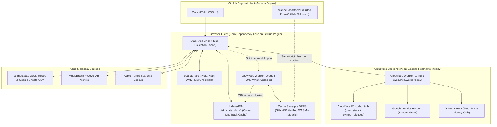

# Disk Crate (`disk-crate`) — Architecture Overview & Phased Roadmap

> [!IMPORTANT]
> **Status: Phase 0 Completed (`cd-hunt` → Disk Crate); Phases 1–3 Planned Architecture (Not Yet Implemented)**
> Phase 0 (Full Rename, branding, GitHub Pages URL migration, and backwards-compatible `window.DiskCrate` / `cd_hunt_*` persistence) is completed. Phases 1–3 below remain **planned design specifications** and do **not** reflect shipped features yet; live operational documentation updates for Phases 1–3 must happen only as each phase ships.

---

## 1. Vision & Product Scope

**Disk Crate** expands the original trip-focused physical CD checklist (`cd-hunt`) into an offline-first physical music companion supporting the entire collector lifecycle:

1. **Track Lists (Shared Release Foundation):** Multi-disc track metadata with explicit provenance (`Catalog` / `Custom` override > `MusicBrainz` > `iTunes`) for buying decisions, search, and track-overlap checks. See [`PHASE1_TRACKLISTS.md`](./PHASE1_TRACKLISTS.md).
2. **Owned Releases Database:** A personal catalog built to scale smoothly to **1,000+ owned CDs** in IndexedDB, backed by incremental Cloudflare D1 cloud sync, lossless JSON import/export, Google Sheet mirroring, and live cross-referencing inside Hunt mode. See [`PHASE2_OWNED_COLLECTION.md`](./PHASE2_OWNED_COLLECTION.md).
3. **Opt-In Camera Scanner (WASM):** A continuous live-viewfinder scanner prioritizing rapid at-home collection cataloging (Barcode/JAN-13 + Catalog Number OCR) plus optional shop lookups and visual cover matching—loading zero scanner bytes until explicitly confirmed by the user, with Wi-Fi pre-download and one-click wipe/reset. See [`PHASE3_CAMERA_SCANNER.md`](./PHASE3_CAMERA_SCANNER.md).

---

## 2. Target System Architecture

---

## 3. Architectural Non-Negotiables

Every phase must uphold the core invariants established in [`AGENTS.md`](../../AGENTS.md) and [`docs/HANDOVER.md`](../HANDOVER.md):

1. **Zero-Dependency Runtime Core:** Normal page loads download **0 bytes** of third-party frameworks, npm bundles, or scanner/WASM code. The camera engine and binary packs load asynchronously only after user confirmation.
2. **Offline-First & Sandbox-Safe Persistence:** Keep `localStorage` wrapped in `try/catch` fallbacks and give the new IndexedDB wrapper (`js/db.js`) a clean in-memory fallback for sandboxed iframes and basement shops without reception.
3. **Zero-Scope GitHub OAuth:** Continue omitting `scope` on `/auth/login`, discarding GitHub's `access_token` immediately in `/auth/callback`, and never storing GitHub credentials or requesting repository write access.
4. **Non-Breaking Backwards Compatibility:** Keep existing `schemaVersion: 1` hunt catalogs valid, seamlessly read/migrate legacy `cd_hunt_*` storage keys and D1 rows, and retain `window.CDHunt` as a compatibility alias alongside `window.DiskCrate`.
5. **Vendor-Neutral Docs & Clean Cover Rules:** Never commit vendor-specific AI instructions or prohibited hotlinked image URLs (`vgmdb.net`, `wikia.nocookie.net`, `fandom.com`, `cdjapan.co.jp`).
6. **Zero Binary Bloat in Git:** Scanner WASM binaries and quantized ML models must never be committed into Git history; they ship via GitHub Releases and are assembled into the GitHub Pages artifact during Actions deployment.

---

## 4. Phased Implementation Roadmap

| Phase | Scope | Primary Modules / Infra Touched | Design Doc |
| --- | --- | --- | --- |
| **Phase 0 *(Completed)*** | Full rename (`cd-hunt` → **Disk Crate** / `disk-crate`), UI rebrand, Pages URL migration, legacy storage compatibility | `index.html`, `js/*.js`, `worker/wrangler.toml`, `worker/index.js`, schemas/docs | Section 5 below |
| **Phase 1** | Shared `tracks[]` / `barcode` schema extension, MusicBrainz + iTunes track resolver, `js/db.js` track cache, Crate Flip tracklist + manual paste override, track-title search, variant-aware matcher | `js/validate.js`, `schemas/catalog.v1.schema.json`, `js/db.js`, `js/track-resolver.js`, `js/app.js`, `css/styles.css` | [`PHASE1_TRACKLISTS.md`](./PHASE1_TRACKLISTS.md) |
| **Phase 2** | Owned Collection DB (~1,000+ releases), `Hunt` \| `Collection` switcher, incremental D1 `sync_seq` sync, lossless JSON & Google Sheet backing, Hunt ↔ Owned overlap badges & graduation | `schemas/collection.v1.schema.json`, `js/db.js`, `js/collection.js`, `js/sync.js`, `js/sheet-adapter.js`, `worker/schema.sql`, `worker/index.js` | [`PHASE2_OWNED_COLLECTION.md`](./PHASE2_OWNED_COLLECTION.md) |
| **Phase 3a** | Opt-in Scanner Manager (manifest + SHA-256 verification + Cache Storage/OPFS + 1-click Wipe), Web Worker lifecycle, live viewfinder, Actions Pages deploy from GitHub Releases | `.github/workflows/deploy-pages.yml`, `js/scanner-manager.js`, `js/scanner-ui.js`, `js/scanner-worker.js`, `scripts/fetch-scanner-assets.mjs` | [`PHASE3_CAMERA_SCANNER.md`](./PHASE3_CAMERA_SCANNER.md) |
| **Phase 3b** | Continuous Tier 1 Barcode/JAN-13 (`BarcodeDetector` + `zxing-wasm`) + Tier 2 Catalog Number OCR (`A-Z0-9-~`) + rapid at-home batch queue | `js/scanner-worker.js`, `js/scanner-ui.js`, `js/collection.js` | [`PHASE3_CAMERA_SCANNER.md`](./PHASE3_CAMERA_SCANNER.md) |
| **Phase 3c** | Optional Tier 3 Front-Cover Visual Matcher (closed-set Hunt + Owned int8 embeddings via `onnxruntime-web`, dual full/obi-crop index, manual cover snap) | `js/scanner-worker.js`, `js/cover-index.js`, `js/scanner-ui.js` | [`PHASE3_CAMERA_SCANNER.md`](./PHASE3_CAMERA_SCANNER.md) |

---

## 5. Phase 0: Full Rename Plan (`cd-hunt` → `Disk Crate` / `disk-crate`) *(Completed)*

Phase 0 executed the chosen **Option B (Full Rename)** while keeping the deployed Cloudflare Worker hostname stable during rollout:

### 5.1 Frontend & Branding
- Update UI titles, `<title>`, headings, Loader copy, and metadata text from **CD Hunt** to **Disk Crate**.
- Introduce `window.DiskCrate` namespace across modular JS files while keeping `window.CDHunt = window.DiskCrate` so existing external tests or scripts degrade gracefully during transition.
- Adopt `disk_crate_*` prefixes for newly introduced stores (`disk_crate_db_v1`), while continuing to read legacy `cd_hunt_*` keys (`cd_hunt_catalog_url_v1`, `cd_hunt_sync_token_v1`, `cd_hunt_sync_api_url_v1`, `cd_hunt_sync_meta_v1`, `cd_hunt_<slug>_<hash>_*`) and keeping `STORAGE_PREFIX_REGEX` in [`worker/index.js`](../../worker/index.js) compatible with existing D1 `user_state` blobs.

### 5.2 GitHub Repository & GitHub Pages
- Rename repository `dopingus-build/cd-hunt` → `dopingus-build/disk-crate` (canonical Pages URL becomes `https://dopingus-build.github.io/disk-crate/`).
- Because browser `localStorage` and `IndexedDB` are partitioned by **origin** (`https://dopingus-build.github.io`) rather than path, existing users retain their local checklists, cover caches, and sync tokens automatically after the repo rename.
- GitHub preserves redirects from `/cd-hunt/` to `/disk-crate/` as long as no new repository takes the old name.

### 5.3 Worker Redirect & Origin Config (Worker Hostname Kept Initially)
- Update `APP_REDIRECT_URL` in [`worker/wrangler.toml`](../../worker/wrangler.toml) and `DEFAULT_APP_REDIRECT_URL` in [`worker/index.js`](../../worker/index.js) from `https://dopingus-build.github.io/cd-hunt/` to `https://dopingus-build.github.io/disk-crate/`.
- `ALLOWED_ORIGINS` (`https://dopingus-build.github.io`) is origin-scoped and requires no change.
- Update canonical URLs in [`schemas/catalog.v1.schema.json`](../../schemas/catalog.v1.schema.json) (`$id`), [`docs/AGENT_CATALOG_GUIDE.md`](../AGENT_CATALOG_GUIDE.md), [`scripts/smoke-live.mjs`](../../scripts/smoke-live.mjs), and companion `cd-metadata` `$schema` links after GitHub Pages is live at the new path.

---

## 6. Deferred TODO: Optional Future Worker Hostname Rename

We intentionally **keep `https://cd-hunt-sync.tndo.workers.dev`** (and D1 database `cd-hunt-db`) for now to avoid disrupting live GitHub OAuth callbacks and multi-device sync during feature development.

When ready to rename the Worker hostname (`cd-hunt-sync` → `disk-crate-sync`), follow this zero-data-loss runbook:

- [ ] **1. Deploy parallel Worker bound to the existing D1 DB:** Create `worker/wrangler.toml` (or deploy script) targeting Worker name `disk-crate-sync` while binding `[[d1_databases]]` to the **exact same `database_id` (`d09adf93-b9ba-4198-896a-5faa1bfcda08`, `cd-hunt-db`)** — zero D1 migration required.
- [ ] **2. Provision secrets on the new Worker:** Set `GITHUB_CLIENT_SECRET`, `JWT_SECRET` (reuse the same `JWT_SECRET` so active 30-day session JWTs and 90-day share tokens remain valid), and `GOOGLE_SERVICE_ACCOUNT_JSON`.
- [ ] **3. Cut over GitHub OAuth callback URL:** Update GitHub OAuth App (`Ov23liJMYOGioIFPGvzK`) Authorization callback URL from `https://cd-hunt-sync.tndo.workers.dev/auth/callback` to `https://disk-crate-sync.tndo.workers.dev/auth/callback` (and update Homepage URL to `https://dopingus-build.github.io/disk-crate/`).
- [ ] **4. Switch frontend config & docs:** Update `syncApiUrl` in [`js/config.js`](../../js/config.js), [`docs/CLOUD_SYNC_ARCHITECTURE.md`](../CLOUD_SYNC_ARCHITECTURE.md), and [`worker/README.md`](../../worker/README.md), verify `scripts/smoke-live.mjs` end-to-end, then retire the old `cd-hunt-sync` Worker.

---

## 7. Documentation Maintenance Matrix

Live operational docs are updated incrementally as each phase lands on `main`:

| Live Document / Schema | Phase 0 | Phase 1 | Phase 2 | Phase 3 |
| --- | --- | --- | --- | --- |
| [`README.md`](../../README.md) | App name, repo/Pages links | Tracklist feature bullet | Collection + sync overview | Opt-in Scanner + Actions Pages deploy |
| [`AGENTS.md`](../../AGENTS.md) | App name, repo constraints | Tracklist rule pointer | Owned collection constraints | Zero-dep core vs. opt-in WASM pack rule |
| [`docs/HANDOVER.md`](../HANDOVER.md) | Branding, storage aliases | `track_cache` in IndexedDB | `owned_releases` store & mode switcher | Scanner worker/cache isolation & assets pipeline |
| [`docs/METADATA.md`](../METADATA.md) | Schema `$id` & URLs | `tracks[]`, `trackSource`, `barcode`, `mbid` | `schemas/collection.v1.schema.json` *(new in Phase 2)* & Owned Sheet spec | — |
| [`schemas/catalog.v1.schema.json`](../../schemas/catalog.v1.schema.json) | `$id`, title, description | Optional `tracks[]`, `trackSource`, `barcode`, `mbid` | — | — |
| [`docs/AGENT_CATALOG_GUIDE.md`](../AGENT_CATALOG_GUIDE.md) | Canonical URLs & links | Guidelines for curating `tracks[]` & `barcode` | Checking user's Owned collection before adding Hunt items | — |
| [`.agents/skills/disk-crate-catalog/SKILL.md`](../../.agents/skills/disk-crate-catalog/SKILL.md) | Rename/alias skill metadata | Track/barcode checklist | Owned-overlap verification workflow | — |
| [`docs/CLOUD_SYNC_ARCHITECTURE.md`](../CLOUD_SYNC_ARCHITECTURE.md) | `APP_REDIRECT_URL`, URL notes | — | D1 `owned_releases`, `sync_seq`, batch sync, collection share, Owned Sheet sync | Worker CORS note if cover proxy added in 3c |
| [`worker/README.md`](../../worker/README.md) | `APP_REDIRECT_URL` runbook | — | New `/api/collection*` endpoints & D1 schema migration | Worker hostname TODO reference |

---

## 8. Cross-Phase Verification Standards

All phases adhere to the repository's zero-npm-dependency test pipeline on Node.js `22.5+`:

- **Unit Tests (`node --test test/*.test.js`):** Pure validation, parsers, matchers, IndexedDB adapters, sync conflict logic, SHA-256 verification, and Worker logic.
- **Integration Tests:** Simulated DOM (`index.html` + `js/*.js`) and Worker HTTP + `node:sqlite` tests covering rate limits, auth guards, kill switches, and offline degradation.
- **Full-Stack System Tests:** End-to-end Frontend VM ↔ loopback HTTP Worker ↔ SQLite convergence tests (multi-device offline edits, tombstones, Sheet write-backs).
- **Browser E2E (`scripts/e2e-browser.mjs`):** Ephemeral Playwright Chromium run (`/tmp/pw`, cleaned up immediately) covering desktop + mobile (`375x812`) layouts, persistence across reloads, synthetic camera stream scans in Phase 3, and live smoke checks (`scripts/smoke-live.mjs`).
