# Phase 3 Design: Opt-In In-Browser Camera Scanner Engine (WASM)

> [!IMPORTANT]
> **Status: Phase 3a Completed (Stage 3a Shell & Asset Pipeline Live); Phases 3b–3c Planned (Not Yet Implemented)**
> Phase 3 adds a continuous live-viewfinder scanner prioritizing **rapid at-home cataloging** into the Owned Collection while supporting **occasional quick in-shop Hunt/Owned lookups**. Normal page loads download **0 bytes** of scanner or WASM code until explicitly confirmed by the user.
> - **Completed (Phase 3a):** Zero-cost lazy UI (`js/scanner-ui.js`, `css/scanner.css`), manifest + SHA-256 Cache Storage pack manager + 1-click Wipe (`js/scanner-manager.js`), single-threaded WASM Web Worker lifecycle + luminance telemetry (`js/scanner-worker.js`), local manual code fallback, and GitHub Releases (`scanner-assets-v1`) → GitHub Actions (`.github/workflows/deploy-pages.yml`) → GitHub Pages asset hosting.
> - **Planned (Phases 3b–3c):** Stage 3b continuous barcode (`BarcodeDetector` / `zxing-wasm`) & spine CatNo OCR decoders + batch tray, and Stage 3c optional front-cover embedding matcher remain planned and are not yet implemented.

---

## 1. Use-Case Priority & UX Philosophy

1. **Continuous Live Viewfinder (No Manual Photo Taking):**
   - Snapping, reviewing, and uploading individual photos is far too slow for a shelf of dozens or hundreds of CDs.
   - Instead, the camera renders a live preview and samples frames (~2–3 fps) inside a **Web Worker**, auto-detecting barcodes or catalog codes on contact with subtle haptic/audio feedback.
2. **Primary Workflow — At-Home Stack Cataloging:**
   - Flip CDs past a phone camera or laptop webcam showing the **JAN-13 barcode** or **spine/back catalog number** (`LACM-24156`, `SRCL-13050`).
   - Detected codes hit a **Batch Queue** tray (with duplicate-frame cooldown), resolve edition + tracks from local DB or MusicBrainz/iTunes, warn if already owned, and commit to IndexedDB + a single `/api/collection/batch` push with 1 click.
3. **Secondary Workflow — Quick In-Shop Lookups:**
   - Briefly aiming at a CD's back/spine in a store displays an instant HUD status banner:
     - **On Hunt List** (shows target price, shelf/filing info, check-off shortcut)
     - **Already Owned** (shows exact edition / notes, or overlapping tracks)
     - **Unknown Release** (shows resolved MusicBrainz/iTunes title + tracklist for quick buying decisions)

---

## 2. Opt-In Lifecycle, Download Manager & Clean Wipe

### 2.1 Zero-Cost Default Guarantee
- Default startup (`index.html`, Hunt mode, Collection mode) loads **0 KB** of camera UI, WASM runtimes, or OCR/ML models.
- Scanner code (`js/scanner-ui.js`, `js/scanner-manager.js`, `js/scanner-worker.js`) loads dynamically only when the user opens the **Scan** view or **Scanner Engine Manager**.

### 2.2 Manifest-Driven Pack Architecture
The scanner reads a small versioned manifest (`/scanner-assets/v1/manifest.json`) describing independent downloadable packs:

| Pack ID | Role | Typical Size | Trigger / Required? |
| --- | --- | --- | --- |
| `barcode-wasm` | `zxing-wasm` fallback reader for EAN/JAN-13 | ~0.4–0.6 MB | **Skipped completely** when native `BarcodeDetector` supports `ean_13` (Chromium/Android). Needed on Safari/Firefox. |
| `catno-ocr` | Compact alphanumeric WASM OCR (`A-Z0-9-~`) for spine & back catalog numbers | ~3–5 MB | Optional Stage 3b pack; no 20–40 MB JP dictionary needed. |
| `cover-embed` | Optional Stage 3c quantized `int8` vision embedding model (`onnxruntime-web`) | ~10–20 MB | Optional Stage 3c closed-set front-cover matcher. |

Each pack entry in `manifest.json` pins exact file paths, `bytes` (for honest pre-download prompts), `version`, and lowercase hex `sha256` digests.

### 2.3 User Confirmation, Pre-Download & Verification
- **Explicit Confirmation Before Download:** Opening **Scan** without required packs shows the exact byte size and pack description (important on metered mobile roaming) before any transfer begins.
- **Manual Wi-Fi Pre-Download & Update:** Users can open **Scanner Engine Manager** at home/hotel on Wi-Fi to pre-download or update packs so scanning works **100% offline** against the local Hunt + Owned DB in basement shops.
- **Integrity Gate:** Every downloaded WASM/model file is hashed via Web Crypto (`crypto.subtle.digest('SHA-256', buf)`). Mismatched or partial transfers are rejected and never written to persistent engine storage.

### 2.4 Storage Isolation & One-Click Wipe
- **Dedicated Binary Bucket:** Verified WASM binaries and weights live strictly in a versioned **Cache Storage** bucket (`disk-crate-scanner-assets-v1`) — or **OPFS** where preferred — completely separate from `localStorage` and IndexedDB's `owned_releases`.
- **Dedicated Embedding Index:** Phase 3c cover embeddings live in a separate IndexedDB store (`scanner_cover_index`), independent of `owned_releases` and `track_cache`.
- **1-Click "Wipe Scanner Engine & Cache" (plus per-pack delete):**
  1. Terminates any active `scanner-worker.js` instance cleanly.
  2. Deletes `disk-crate-scanner-assets-v1` (Cache Storage / OPFS) and clears `scanner_cover_index`.
  3. Resets scanner engine state to `not-downloaded` while guaranteeing **zero modifications** to Hunt checklists, `track_cache`, or `owned_releases`.

---

## 3. Asset Hosting & Browser Runtime Constraints

### 3.1 Hosting Pipeline: GitHub Releases → GitHub Actions → GitHub Pages

Direct browser `fetch()` against `https://github.com/<owner>/<repo>/releases/download/...` fails CORS because GitHub issues a `302` redirect to `objects.githubusercontent.com`, which omits `Access-Control-Allow-Origin` headers.

To keep **git history binary-free**, consume **zero Cloudflare Worker quota**, and guarantee **same-origin CORS-free loading**, Phase 3 uses this build pipeline:

```text
GitHub Release tag (e.g. scanner-assets-v1)
   │  Holds signed/hashed .wasm + quantized model packs + manifest.json (0 binary files in git)
   ▼
GitHub Actions (.github/workflows/deploy-pages.yml)
   │  1. Run unit/integration tests
   │  2. Download pinned scanner-assets-v1 release archive & verify SHA-256
   │  3. Place into staging folder under /scanner-assets/v1/
   │  4. Upload & publish via actions/upload-pages-artifact + actions/deploy-pages
   ▼
GitHub Pages (https://dopingus-build.github.io/disk-crate/scanner-assets/v1/...)
   └── Served same-origin with application/wasm, zero CORS issues, zero Worker bandwidth
```

- **Local Development Trade-Off:** Because binaries are absent from a fresh `git clone`, add:
  - A small dev helper `scripts/fetch-scanner-assets.mjs` fetching the pinned release into a `.gitignore`-d `scanner-assets/` folder, **and/or**
  - An explicit dev override (`?scannerAssets=...`, mirroring `?syncApi=`) so local testing can reuse published Pages assets.
- **Disadvantage Check:** Requires switching repository GitHub Pages deployment from default branch publishing to **GitHub Actions** (`deploy-pages.yml`), adding ~5–10s per deploy in CI while staying far below GitHub Pages' 1 GB artifact limit.

### 3.2 Browser Engine & Memory Budget
- **No `COOP`/`COEP` Assumption:** GitHub Pages does not allow custom `Cross-Origin-Opener-Policy` / `Cross-Origin-Embedder-Policy` headers (and enabling `COEP` breaks cross-origin album art loading). All WASM engines must target **single-threaded WASM SIMD** (widely supported in Safari, Chrome, and Firefox) plus optional **WebGPU** fallback without requiring `SharedArrayBuffer`.
- **iOS Safari Memory Ceiling (~300–500 MB):**
  - Keep quantized models compact (`int8`, `<= 20 MB`).
  - Run all decoding/inference inside a dedicated **Web Worker**.
  - **Terminate the Web Worker immediately when closing the Scanner modal** (with a short idle timeout if needed) so Safari reclaims WASM heap memory before returning to large card grids.

---

## 4. Progressive 3-Tier Recognition Pipeline

```mermaid
flowchart LR
    Cam["getUserMedia Video Stream"] --> Sampler["Canvas Frame Sampler (2-3 fps)"]
    Sampler --> Worker["Scanner Web Worker (Isolated WASM)"]
    Worker --> T1["Tier 1: Barcode / JAN-13 (0-0.6 MB)"]
    T1 -->|Not found or occluded| T2["Tier 2: CatNo OCR A-Z0-9-~ (3-5 MB)"]
    T2 -.->|Optional Stage 3c pack| T3["Tier 3: Front Cover Embedding (10-20 MB)"]

    T1 --> Match["Offline Matcher (Hunt + Owned IDB)"]
    T2 --> Match
    T3 --> Match

    Match -->|Online unknown lookup| API["MusicBrainz & iTunes Lookup"]
    Match --> HUD["Live HUD & Rapid Batch Tray"]
    API --> HUD
    HUD -->|1-Click Add or Batch Commit| IDB["IndexedDB + Batched D1 Push"]
```



### 4.1 Stage 3a — Engine Shell, Download Manager & Live Viewfinder
- **`getUserMedia` Acquisition:** Prefer `{ video: { facingMode: { ideal: 'environment' }, width: { ideal: 1280 }, height: { ideal: 720 } } }` with camera switcher for desktop webcams and torch/flashlight toggle where `track.getCapabilities().torch` exists.
- **Viewfinder Overlay:** Guide reticle tailored to barcodes/spines (horizontal guide band + optional full-square guide for Stage 3c), live status pill, online/offline indicator, and explicit permission-denied / no-camera manual-entry fallback.
- **Engine Manager UI:** Shows pack sizes, download/ready/error status, SHA-256 verification status, offline cache footprint, **Pre-Download All**, and **Wipe Scanner Engine & Cache**.

### 4.2 Stage 3b — Tier 1 (Barcode) + Tier 2 (Catalog Number OCR)
- **Tier 1 — Barcode / JAN-13:**
  - Feature-detect `window.BarcodeDetector` (`BarcodeDetector.getSupportedFormats()` containing `'ean_13'`). When supported natively, run zero-download decoding; otherwise load `barcode-wasm` (`zxing-wasm`).
  - Normalize valid EAN-13 / JAN-13 codes (Japanese releases start with `49` or `45`, alongside standard UPC/EAN).
  - Match locally against `owned_releases.barcode` + active Hunt `items[].barcode`, falling back online to MusicBrainz `barcode:<ean>` (`+ inc=recordings`) and resolving cover art via existing MusicBrainz/iTunes helpers.
- **Tier 2 — Spine / Back Catalog Number OCR:**
  - Japanese CDs almost universally print `PREFIX-DIGITS` (`LACM-24156`, `SRCL-13050`, `CPCA-1043~4`) on spines and back inserts — essential when Book-Off/Suruga-ya price stickers obscure the barcode or when MusicBrainz lacks `barcode` metadata.
  - Restrict the OCR recognizer strictly to `[A-Z0-9-~]` with high-contrast ROI preprocessing and extract matches via `/\b([A-Z]{2,6}-\d{3,6}(?:[~～〜]\d+)?)\b/` (aligning with `SHEET_CAT_CODE_REGEX` in [`worker/index.js`](../../worker/index.js)), normalizing fullwidth tildes and resolving base-disc prefixes.
  - Match locally against normalized `regCatNo`, `mbEditions[].catno`, and `owned_releases.catNo`, then fall back online to MusicBrainz `catno:` + iTunes lookup.
- **Batch Queue UX (At-Home Speed):**
  - Maintain a **2-second per-code cooldown** so holding a CD steady does not queue duplicates.
  - Show a compact scrolling **Scan Tray** (`3 queued · 1 already owned warning`) letting the user inspect/remove false hits, optionally fill purchase notes, and click **Add All to Collection** (one IndexedDB transaction + one `/api/collection/batch` cloud push).

### 4.3 Stage 3c — Optional Tier 3: Front-Cover Visual Matching
- **Explicit Closed-Set Scope:** Visual embedding matching operates strictly over the **closed set** of covers present in the user's active **Hunt Catalog + Owned Collection** (100–2,000 items → `< 1 ms` brute-force float32 cosine similarity in JS). Open-world identification for uncataloged CDs continues relying on Tier 1 (Barcode) + Tier 2 (CatNo OCR) + MusicBrainz/iTunes.
- **Japanese Jewel-Case Obi Strategy:** Compute **two normalized embeddings per cover** during local indexing — full square jacket + right-80% crop — so physical CDs with a vertical obi strip covering the left 15–20% still match high-confidence top-1/top-3 candidates.
- **Rare Indie/Doujin Cover Capture:** Allow optionally capturing and cropping a local front-cover thumbnail inside Edit Release if an obscure disc has no online MusicBrainz/iTunes art.
- **CORS Verification Requirement for Indexing Cover Art:** Drawing remote `` pixels onto an offscreen canvas (`ctx.getImageData`) requires CORS permission (`crossOrigin="anonymous"`). Before building Stage 3c, audit live `Access-Control-Allow-Origin` headers on `coverartarchive.org` / `archive.org` redirects and Apple `mzstatic.com`. If any cover source blocks CORS canvas reads, add a strictly allowlisted cover-domain fetch route to the Cloudflare Worker purely for on-demand index building.

---

## 5. Verification & Acceptance Criteria

### 5.1 Automated Tests (`node --test test/*.test.js`)
- **Unit tests:**
  - `manifest.json` parser & validator, SHA-256 verification passing valid bytes and rejecting tampered/corrupted bytes cleanly.
  - Cache Storage / OPFS + `scanner_cover_index` isolation and full Wipe flow verifying Hunt & Owned IndexedDB stores remain untouched.
  - Barcode (JAN-13/EAN-13) validator, OCR catalog-code extractor (handling `0`/`O` or tilde cleanup heuristics), cooldown debouncer, and batch queue deduplication.
  - Cosine similarity ranker & obi-crop threshold logic (Stage 3c).
- **Integration tests:**
  - Strict opt-in gating: assert **0 network requests** to `/scanner-assets/` until user clicks confirm in the mocked UI.
  - Mocked `scanner-worker.js` pipeline resolving local Hunt match, Owned duplicate warning, and online MusicBrainz enrichment, then committing batch to `js/db.js`.
- **Headless Chromium E2E (`scripts/e2e-browser.mjs`):**
  - Mock `/scanner-assets/v1/manifest.json` + pack payload on a local test server.
  - Verify opt-in confirmation prompt shows expected download bytes → confirm download → assert Cache Storage entry created → wipe scanner → confirm Cache Storage bucket removed while Owned collection persists.
  - Synthesize a `<canvas>.captureStream()` video feed rendering a high-contrast JAN-13 barcode and/or catalog string, exercise the continuous live loop → Batch Tray → **Add to Collection**, and verify persistence across page reload.

### 5.2 Real-Device Manual Test Checklist (Required Before Marking Phase 3 Done)
- [ ] **iOS Safari & Android Chrome:** Rear camera focus on glossy CD jewel-case shrinkwrap, torch toggle, and returning cleanly from Scan modal without tab memory reloads.
- [ ] **Airplane-Mode / Basement Shop Simulation:** Pre-download packs on Wi-Fi, enable Airplane Mode, scan both a Hunt catalog CD and an Owned CD, confirm offline instant HUD match and offline batch save.
- [ ] **Real Sticker / Obi Occlusion Test:** Test Tier 2 Catalog Number OCR when a price tag covers the barcode, and Tier 3 dual-crop matching with an obi strip present.

### 5.3 Live Docs to Update When Phase 3 Ships
- `.github/workflows/deploy-pages.yml` *(new in Phase 3a)* (plus release pack publishing notes)
- [`AGENTS.md`](../../AGENTS.md) & [`docs/HANDOVER.md`](../HANDOVER.md) (documenting zero-dependency core + opt-in WASM policy & local dev asset script)
- [`README.md`](../../README.md) & (if Stage 3c added a cover-index proxy route) [`docs/CLOUD_SYNC_ARCHITECTURE.md`](../CLOUD_SYNC_ARCHITECTURE.md)
